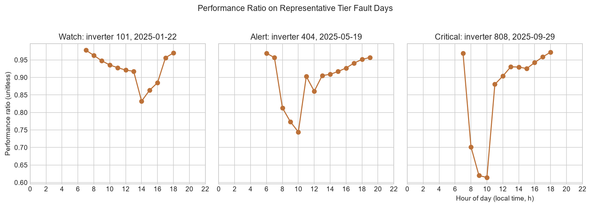

# Initial Insights

## 1. Problem Statement

This analysis asks when inverter-hours fall below the fleet's same-hour PR median. At each timestamp, `pr_gap` is the median valid PR across all inverters minus that inverter's PR. A flag is a rolling set of three consecutive hours, each with valid PR and irradiance above 200 W/m², whose mean `pr_gap` is at least 0.05. The analysis uses compact outputs from modeled 2025 hourly data, not equipment causes.

## 2. Summary Statistics

The saved summary statistics describe 7,270,800 inverter-hour records. Mean AC power is about 15.38 kW and mean plane-of-array irradiance is about 223.1 W/m². Mean PR is about 0.929 across 3,824,640 valid rows; 3,446,160 PR values are null because irradiance is zero at night.

The PR values are unitless, and the null nighttime values are expected because PR has no defined irradiance denominator at zero irradiance. Full descriptive statistics and missing-value counts are in [summary_statistics.csv](../output/tables/summary_statistics.csv).

## 3. Charts

### Mean PR by Hour of Day

Mean daytime PR is higher in the early and later daylight hours and lower around midday. This is a pattern in the modeled hourly summaries; the chart does not identify why it occurs.

### Monthly Mean PR: Faulted and Non-faulted Inverters

The monthly faulted and non-faulted group averages are very close across the year. Only three of 830 modeled inverters have injected fault windows, so the monthly group means dilute those few hours and should not be read as a sensitive fault detector.

### PR on Representative Tier Fault Days

The three panels show one representative inverter-day for each designed positive tier, with the selected windows and hourly values read from the fault list and processed computation table. The chart provides day-level context; the validation table checks every one of the 15 configured windows, including the three hard expected misses.

### Irradiance and AC Power

AC power generally rises with plane-of-array irradiance, and the horizontal reference line marks the modeled 60 kW rated AC clip. The chart uses the retained fixed-seed sample of 100,000 rows and shows the broad relationship rather than every inverter-hour.

## 4. Cautious Inference

Weighting monthly means by daytime-row counts gives a faulted-hour mean PR of 0.929159 and a non-faulted-hour mean PR of 0.929253. The positive test windows are sparse within all inverter-hours; the separate validation table, rather than these pooled monthly means, records the detector outcome.

The requested simple correlation between module temperature and PR could not be calculated: the permitted compact tables contain no paired observations of both variables. A correlation cannot be recovered from separate or aggregate summaries. Faults are injected into simulated data, so this analysis checks the detector against test scenarios and does not show real-world causes; no causal claim is made.

## 5. Conclusion and Limitations

The charts describe hourly and monthly PR patterns, PR values around one representative window per target tier, and the relationship between irradiance and modeled AC power. The rolling rule flagged 35 blocks across 13 of 830 inverters (1.57%): 16 Watch, 15 Alert, and 4 Critical. It detects 12/12 designed tier windows with target matches; three hard cases are missed as intended because two gaps are below 0.05 and the remaining Alert-sized gap lasts only two hours.

## Detection Result

All three hard cases were missed as expected: the two below-Watch cases have mean gaps of 0.02499 and 0.03497, while the two-hour case has a 0.14997 mean gap but does not satisfy the required three consecutive hours. The designed test result is not real-world accuracy. Zero false alarms are expected on the identical non-faulted simulated inverters; the check says nothing about noisy real data.

These are modeled results based on hourly reanalysis weather and synthetic fault injections, not field measurements of inverter faults. Nighttime PR is undefined because its irradiance denominator is zero. The available compact files do not contain paired module-temperature and PR values, so that correlation remains unmeasured; further conclusions would require paired observations and real plant telemetry.
