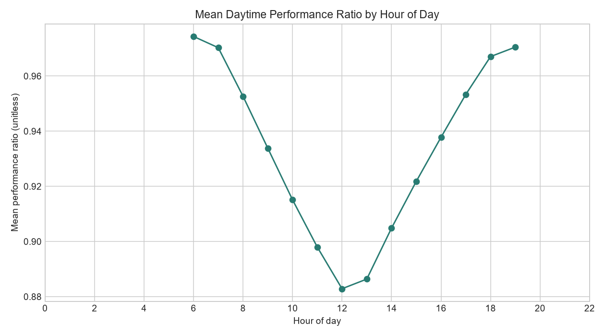
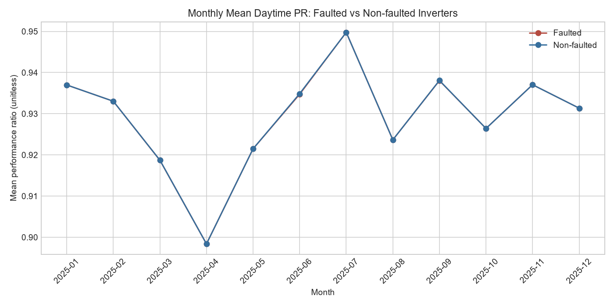
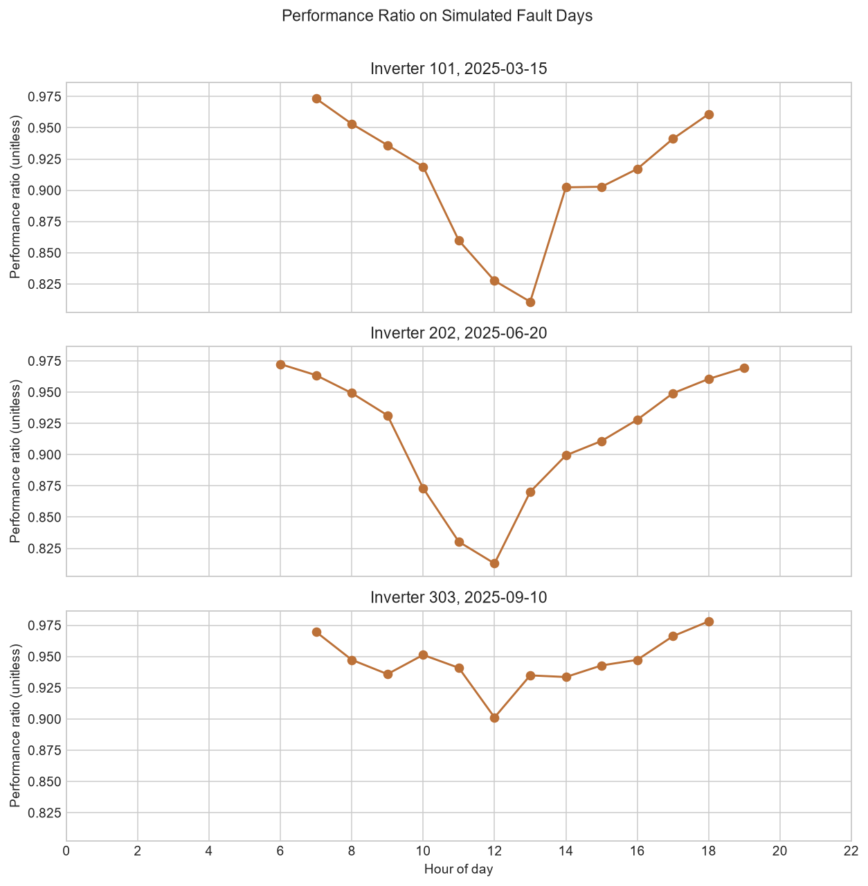
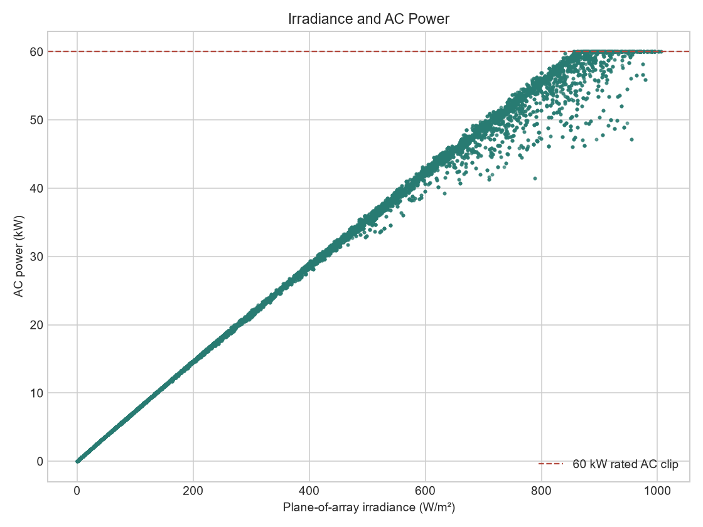

# Initial Insights

## 1. Problem Statement

This analysis asks when and where inverter-hours show negative performance-ratio gaps in the solar plant dataset. It uses compact outputs from the modeled 2025 hourly data to summarize initial patterns, not to establish equipment causes.

## 2. Summary Statistics

The saved summary statistics describe 7,270,800 inverter-hour records. The overall mean performance ratio among valid daytime rows is about 0.929; 3,446,160 PR values are null because irradiance is zero at night, not because those records were removed. The processed metrics also have a mean irradiance of about 223.1 W/m² and mean AC power of about 15.38 kW.

See `output/tables/summary_statistics.csv` for the descriptive statistics and missing-value counts by key field.

## 3. Charts

### Mean PR by Hour of Day

Mean daytime PR is highest in the early and later daylight hours, and is lower around midday. This pattern is descriptive and may reflect the modeled weather and performance calculations; the chart alone does not identify a cause.

### Monthly Mean PR: Faulted and Non-faulted Inverters

The faulted and non-faulted group averages are very close across the year, with small differences in months that include injected fault scenarios. Because only three inverters have injected windows among 830 modeled inverters, these group-level monthly averages dilute those limited hours.

### PR on the Three Fault Days

The three traces show hourly PR for inverter 101 on March 15, inverter 202 on June 20, and inverter 303 on September 10, 2025. Lower PR values appear during or near the configured injected windows in these simulated records, which is consistent with the scenarios used to check the analysis workflow.

### Irradiance and AC Power

AC power generally rises with plane-of-array irradiance, while values reach the modeled 60 kW rated AC clip. The scatter uses a fixed-seed, 100,000-row sample from the full processed metrics output and is intended to show the broad relationship.

## 4. Cautious Inference

The monthly group table can be weighted by daytime-hour counts to compare the mean PR across all valid inverter-hours. The faulted group remains close to the non-faulted group overall, which suggests that the three limited injected windows have a small effect on the fleet-wide average; this is consistent with their small share of all inverter-hours, not evidence about real equipment.

A simple correlation between module temperature and PR could not be calculated from the available compact tables. They contain aggregate temperature statistics or PR-only records, but no paired module-temperature and PR observations; a correlation from these files would not be valid. Faults are injected into simulated data, so these checks assess the analysis workflow and do not show real-world causes. No causal claim is made.

## 5. Conclusion and Limitations

The compact results describe a daytime hourly PR pattern, close monthly group averages, and lower PR observations around the simulated fault windows. The irradiance-versus-AC chart also shows the configured AC output cap.

These are modeled results based on hourly reanalysis weather and synthetic fault injections, not field measurements of inverter faults. Nighttime PR is undefined because its irradiance denominator is zero. The compact files do not contain paired module-temperature and PR values, so that requested correlation remains unmeasured here; further conclusions would require such a paired sample and real plant telemetry.
