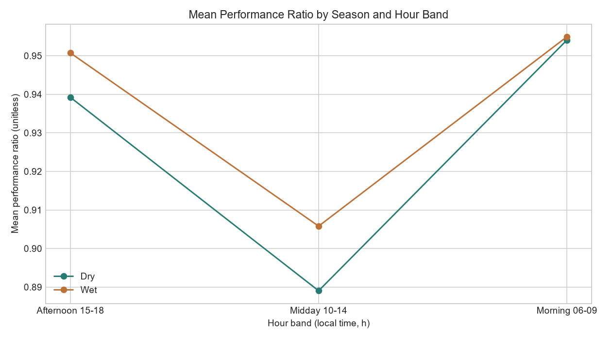
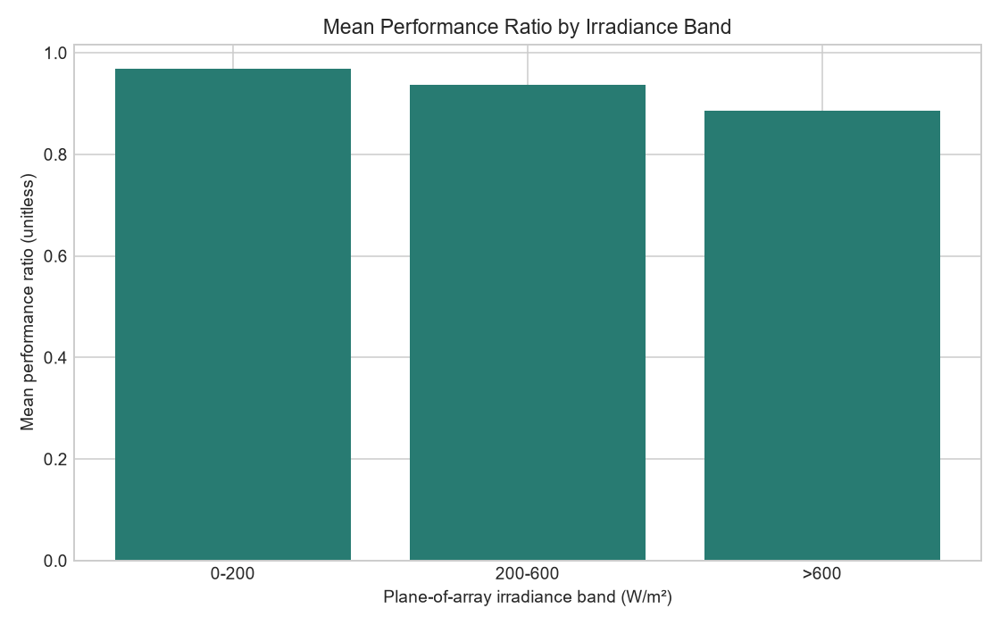
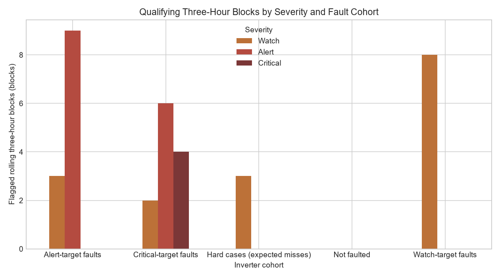

# Segmentation Analysis

## Inverter-Hour PR Identity Check

A chunked comparison of the full processed dataset found identical valid PR values across non-faulted inverters for every shared hour: 827 non-faulted inverters, 4,608 valid timestamps, and zero timestamps with differing PR. Therefore, the fleet-level segmentation is by time and fault cohort, not by individual non-faulted inverter. The fault cohort comparisons remain separate because injected faults alter the modeled inverter-hour PR.

## Definitions

- **Season:** Dry is December through May; Wet is June through November.
- **Hour band:** Morning is 06:00–09:00, midday is 10:00–14:00, and afternoon is 15:00–18:00. Other hours are excluded from this table; PR is null for modeled nighttime rows.
- **Irradiance band:** 0–200, above 200 through 600, and above 600 W/m². Bands use the row's plane-of-array irradiance. PR means use valid, non-null PR rows.
- **Cohort:** Injected windows are grouped as Watch-target faults, Alert-target faults, Critical-target faults, and Hard cases (expected misses); all other inverters are Not faulted. Overall cohort means use all valid PR rows. Each fault-window comparison uses its configured window and non-faulted rows at the same timestamps. All window definitions come from `transform.FAULT_WINDOWS`.
- **PR gap:** At each timestamp, `pr_gap = median valid PR across all inverters at that hour - that inverter's PR at that hour`. This peer-relative gap is distinct from the fleet mean shortfall from PR 1.0.
- **Flagged blocks:** Rolling sets of three consecutive exact hourly timestamps, each with irradiance above 200 W/m² and non-null PR. A qualifying block has a mean of its three hourly `pr_gap` values of at least 0.05. Severity is Watch from 0.05 to below 0.10, Alert from 0.10 through 0.20, and Critical above 0.20. Counts include overlapping rolling windows and come from the same SQL result used by the KPI and insight tables.

## Mean PR by Season and Hour Band

Mean PR is higher in the morning than midday in both seasons, and the midday mean is the lowest of the three hour bands. Wet-season means are modestly above dry-season means in each band; this is a descriptive difference in the modeled year, not evidence that season caused the change.

## Mean PR by Irradiance Band

The saved means decline from 0.968 in the 0–200 W/m² band to 0.937 in the 200–600 band and 0.886 above 600 W/m². The lowest-irradiance band includes valid PR values and should not be read as nighttime performance, since nighttime PR is undefined and excluded.

## Flagged Blocks by Severity and Fault Cohort

The regenerated output has 35 qualifying rolling blocks: 16 Watch, 15 Alert, and 4 Critical, with no blocks in the Not faulted cohort. Watch-target faults contribute 8 Watch blocks; Alert-target faults contribute 3 Watch and 9 Alert blocks; Critical-target faults contribute 2 Watch, 6 Alert, and 4 Critical blocks. Hard cases contribute 3 Watch blocks from the two-hour case's overlapping qualifying rolling windows in the broader SQL stream; these rolling-block counts are not one-to-one counts of test windows.

## Detection Result

The validation table detects all 12 tier-designed windows with matching targets: Watch 4/4, Alert 4/4, and Critical 4/4. It misses all three hard cases as intended: two have mean gaps below 0.05, and the remaining Alert-sized gap lasts only two hours. The 12/12 is a deterministic rule check, not evidence of real-world accuracy.

## Cautious Inference

Across all valid PR rows, faulted windows have weighted mean PR 0.929159 and the non-faulted cohort has weighted mean PR 0.929253. These values aggregate 15 configured faulted inverters and 815 non-faulted inverters, respectively; the comparison is consistent with the injected model changes but does not establish a real-world signature or causal effect.

## Limitations

These are descriptive summaries of modeled weather and simulated fault windows, not real equipment measurements or maintenance thresholds. Non-faulted inverters share identical modeled weather and PR, so zero false-alarm blocks are expected; this checks identical peers only and says nothing about noisy real data. Seasonal comparisons cover one modeled calendar year, irradiance bands have different row counts, and overlapping flagged blocks are not independent events. The threshold tiers are demonstration rules and should not be used as validated operational limits.